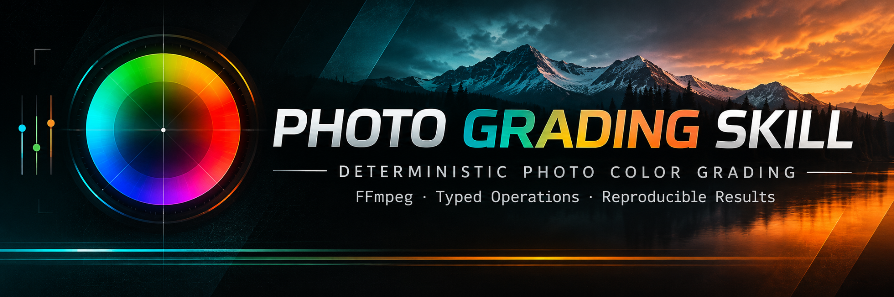
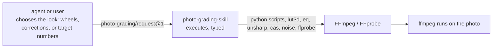
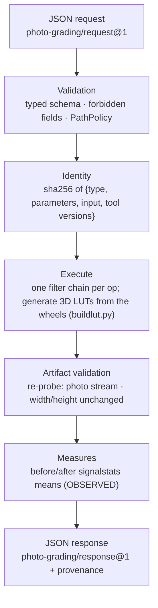

<p align="center">
  <picture>
    
  </picture>
</p>

<p align="center">
  
  
  
  
</p>

# photo-grading-skill

**Deterministic photo color grading / photo color correction execution.**

The most popular cinematic photo look — the **Teal & Orange** split — built from color
theory research: shadows tinted teal (cool, complementary to skin), highlights tinted
orange. But the skill is not limited to it: every wheel is independent, so you can build
any look — warm & nostalgic, cool & clinical, muted, desert, forest, neon, vintage, any hue
you want. It executes exactly what you ask for, deterministically, and reports real
before/after measurements. **Not an AI agent: it never decides which look to apply, never
judges a photo "cinematic", and never picks values on its own.** Its critic measures how far
a photo is from a target look *you* supply as numbers; that is measurement, not judgment.

Typed operations · Validated photos · Full provenance · Real measurements (OBSERVED, never inferred).

> The 3-way wheels work like Adobe Lightroom / Camera Raw's Color Grading panel: Shadows /
> Midtones / Highlights (and Global) each carry a hue, a saturation and a luminance; Blending
> and Balance control how the zones interact. See [knowledge.md](knowledge.md) for the full
> research dump — every technique below was sourced from working tutorials and color-theory
> guides (Teal & Orange, HSL, Curves, complementary colors, skin-tone protection, etc.).

---

## Contents

[What it is, and what it is not](#what-it-is-and-what-it-is-not) ·
[Quick start](#quick-start) · [How it works](#how-it-works) ·
[Supported operations](#supported-operations) · [Critic and optimizer](#critic-and-optimizer) ·
[Deterministic execution](#deterministic-execution) ·
[Artifact validation](#artifact-validation) · [Provenance](#provenance) ·
[Security](#security) · [Built for agents](#built-for-agents) ·
[Errors](#error-handling) · [Docs](#docs) · [Testing](#testing) ·
[Support](#support) · [License](#license)

---

## What it is, and what it is not

| | |
|---|---|
| **Does** | execute `PHOTO_GRADING` (3-way wheels: shadows/midtones/highlights/global with hue, saturation, luminance + blending + balance), `PHOTO_CORRECTION` (white balance, exposure, contrast, levels, vibrance, tone curve, sharpness, clarity, grain), `PHOTO_HSV` (per-hue-family HSL), `PHOTO_LUT_APPLY` (3D `.cube` LUT), as a typed operation DAG on top of FFmpeg, with output validation and provenance; `inspect` reports objective pixel statistics; `PHOTO_ANALYZE`/`PHOTO_SCORE` measure a photo in OKLab against a target the caller supplies as six numbers; `PHOTO_OPTIMIZE` searches eight grade parameters for the best score, bakes the winner into a LUT and renders it once |
| **Does not** | decide *which* color treatment or look to apply, judge a photo "cinematic", auto-select a LUT or correction values, auto-correct color (white balance takes explicit temperature/tint), choose the target look, invent values, run `ffmpeg` filters directly, accept a command, argv or filter string |

That split is the whole design, and it is what makes the skill robust: **the caller (an AI
agent or a person) decides the look; the skill executes it safely and deterministically.**

## Quick start

Requirements: Python 3.9+ (standard library only) and `ffmpeg` / `ffprobe` on `PATH`.
The critic/optimizer operations need the optional extra: `pip install -e ".[critic]"`
(numpy + Pillow). The core operations stay standard-library + FFmpeg only.

```bash
# 1. install
pip install -e .

# 2. check the environment (ffmpeg/ffprobe, photo filters, path policy)
photo-grading doctor --json

# 3. read the machine-readable contract (for agent frameworks)
photo-grading skill --json | head -40
```

Write a request (see [Supported operations](#supported-operations) for the shape):

```json
{
  "schema": "photo-grading/request@1",
  "project": {
    "project_id": "grade-1",
    "source": {"source_id": "photo.jpg", "path": "photos/sunset.jpg"},
    "operations": [
      {"op_id": "grade", "type": "PHOTO_GRADING", "input": "source",
       "parameters": {"shadows_hue": 190, "shadows_saturation": 25,
                      "highlights_hue": 40, "highlights_saturation": 20}}
    ],
    "outputs": [{"output_id": "graded", "operation": "op:grade", "path": "out/graded.jpg", "format": "jpg"}]
  }
}
```

Then plan (read-only) and run:

```bash
photo-grading plan request.json --json    # dry run: plan + geometry, writes no media
photo-grading run request.json --json     # execute; stdout: exactly one photo-grading/response@1 document
```

`ok: true` and `outputs[0].status: "completed"` mean the photo exists at `out/graded.jpg`,
was re-probed, and matched what `PHOTO_GRADING` was supposed to have done. A second run
reuses the intermediate (`"reused": true`).

## How it works





Every box is mechanical; the only judgement call (the look) already happened upstream. The
critic path is the same pipeline with a measurement stage: analyze → score against the
caller's target → deterministic coordinate descent on a proxy → bake the winner into a LUT →
one full-size render through `lut3d`.

## Supported operations

| Operation | Purpose | Parameters |
|---|---|---|
| `PHOTO_GRADING` | 3-way Color Grading wheels | `shadows_hue`, `shadows_saturation`, `shadows_luminance`, `midtones_hue`, `midtones_saturation`, `midtones_luminance`, `highlights_hue`, `highlights_saturation`, `highlights_luminance`, `global_hue`, `global_saturation`, `global_luminance`, `blending` (0-100, default 50), `balance` (-100..100, default 0) |
| `PHOTO_CORRECTION` | Base corrections | `white_balance_temperature` (2500-10000, default 6500), `white_balance_tint` (-100..100, default 0), `exposure` (-10..10), `contrast` (-100..100), `highlights`/`shadows`/`blacks`/`whites` (-100..100), `saturation` (-100..100), `vibrance` (-100..100), `sharpness` (0..100, default 25), `clarity` (0..100), `grain` (0..50), `chroma_denoise` (0..100, chroma-only), `tone_blacks`/`tone_shadows`/`tone_midtones`/`tone_highlights`/`tone_whites` (0..2) |
| `PHOTO_HSV` | Per-hue-family HSL | `red_*`/`orange_*`/`yellow_*`/`green_*`/`cyan_*`/`blue_*`/`magenta_*` with `_hue` (-100..100 = -40..40°), `_saturation` (-100..100), `_luminance` (-100..100) |
| `PHOTO_LUT_APPLY` | Apply a 3D `.cube` LUT | `lut_path` (required), `strength` (0..1) |
| `PHOTO_ANALYZE` | OKLab measurement, no pixels changed | `max_pixels` (1000..5,000,000, default 250,000) |
| `PHOTO_SCORE` | Measurement + score against a target | `target` (six required numbers, see below), `max_pixels` |
| `PHOTO_OPTIMIZE` | Deterministic critic loop, LUT render | `target`, `iterations` (1..200, default 40), `proxy_size` (64..1024, default 384), `lut_size` (17/33/65, default 33) |
| `WHITE_BALANCE` *(alias)* | White balance | `white_balance_temperature` + `white_balance_tint`; resolved to `PHOTO_CORRECTION` at validation |

### Wheel semantics

Each wheel carries a **hue** (color direction), **saturation** (how strong) and
**luminance** (-100..100) applied within its zone. Zones are BT.709 luma bands:

- **shadows**: luma below the low boundary; **highlights**: luma above the high boundary;
  **midtones**: between them.
- **balance** (-100..100): moves the boundaries (positive = wider midtones, negative =
  shadows pull into midtones).
- A wheel with `saturation > 0` rotates a pixel's hue by the wheel's hue and scales its
  saturation by `saturation/100` within its zone; near-black zone pixels get a small
  brightness floor so the tint is visible.
- `blending` (0-100): mixes the tinted LUT back toward identity; 0 = no wheels.
- The **global** wheel applies after the zone tints.

### Classic looks (all built the same way — [knowledge.md](knowledge.md))

| Look | Shadows | Midtones | Highlights |
|---|---|---|---|
| Teal & Orange | hue ~190, sat ~25 | neutral or a hint of shadow hue | hue ~40, sat ~10-25 |
| Warm & Nostalgic | soft neutral | warm golds | warm oranges |
| Cool & Clinical | pale blues | cool grays | neutral |
| Muted Vintage | desaturated teals | desaturated neutrals | desaturated |
| Autumn Dusk | deep browns | rusts | burnt oranges |

## Critic and optimizer

The critic is the measurement half of "grade, then check". It never chooses a look: a target
is six numbers supplied by the caller, with no look names and no presets.

| Target field | Range | Meaning |
|---|---|---|
| `shadow_hue`, `highlight_hue` | 0..360 | OKLab hue angle of the tint measured in the shadow / highlight quartiles. 0 = red/magenta (+a), 90 = yellow (+b), 180 = green (−a), 270 = blue (−b); teal ≈ 200, orange ≈ 55 |
| `tint_mag` | 0..0.20 | OKLab chroma added in each zone; 0.02–0.05 is a normal split tone. Values below 0.005 are treated as "no tint" because the hue is below the visible floor |
| `colorfulness` | 0..150 | Hasler–Süsstrunk M3: ~30 clinical, ~45 average, 60+ punchy |
| `median_L` | 0..1 | Target median OKLab L; 0.45–0.65 is a normal photo |
| `spread` | 0..1 | Target p95 − p05 OKLab L spread |

`PHOTO_ANALYZE` re-encodes the input losslessly and attaches a `report` (it changes no pixels):
median L, p05/p95 spread, clipping, near-neutral cast, M3 colourfulness, shadow/highlight tint
hue and magnitude, skin-hue shift, mean OKLab distance. `PHOTO_SCORE` adds a 0..100 score and
lists **every** penalty term: `exposure`, `contrast`, `clipping`, `colorfulness`,
`shadow_hue`, `highlight_hue`, `tint_strength`, `skin`, `overcooked`. Cast is measured and
reported but not penalized: a deliberate tint is a look, not an error.

`PHOTO_OPTIMIZE` runs deterministic coordinate descent on a ~384 px proxy over eight
parameters: `exposure`, `contrast`, `saturation`, `sh_hue`, `sh_amt`, `hi_hue`, `hi_amt`,
`balance`. The winner is baked into a 3D `.cube` LUT, re-scored on the proxy through numpy
trilinear interpolation (the same result `lut3d` renders), then rendered **once** at full size
through the normal FFmpeg path. Only improving steps are accepted, so the loop cannot return a
worse image than it started with; if the full render would still score below the untouched
image, it re-renders with an identity LUT. No RNG, no FFmpeg inside the loop.

```bash
pip install -e ".[critic]"                 # numpy + Pillow

photo-grading analyze photo.jpg --json
photo-grading score photo.jpg --target target.json --reference original.jpg --json
photo-grading optimize original.jpg --target target.json --out graded.png \
    --lut-out look.cube --iterations 40 --json
```

The standalone `analyze`/`score` commands default the reference to the image itself, so all
deltas and tints are zero; pass `--reference original.jpg` to measure a grade. Inside a
request DAG, `PHOTO_ANALYZE`/`PHOTO_SCORE` measure their input against the project source, so
a score describes the grade at that point in the chain.

**What the score is not:** it is distance to the target *you* supplied, plus two hard guards
(skin-hue shift and an overcooked-distance limit). A strong look can score below 100 when it
deliberately shifts skin or moves far from the original; the guards are constraints, not a
claim about quality. The critic never says a photo is "cinematic", never picks a look, and
never invents a target.

A learned aesthetic model (e.g. LAION) is deliberately not part of the score. If one is added
later, it may only **rank candidates of the same image**; an absolute learned score would
reintroduce the judgment this skill exists to avoid.

## Deterministic execution

Every operation gets an identity — `sha256` over canonical JSON of `{type, parameters,
input hash, tool versions, skill version, pipeline fingerprint}` — computed before anything
runs. Two things follow:

- **Reuse.** Re-running the same request with the same input reuses the intermediate
  instead of re-encoding (a rerun that deletes the output file just re-copies the reused
  intermediate back). The identity hashes the operation's *actual* input artifact, and the
  pipeline fingerprint covers `buildlut.py`/`executor.py`/`model.py`/`critic.py`, so a changed
  upstream op or an upgraded engine invalidates stale caches. `--no-reuse` disables reuse.
- **Stable identifiers.** No timestamps, no UUIDs; LUT filenames are `sha256(content)[:16]`,
  so identical parameter values produce identical filenames on every machine.

## Artifact validation

This skill does not trust `0` as proof a grade happened. Every artifact is re-probed:
exists, non-empty, has a photo stream, width/height unchanged from the source (tolerance
1px), readable — plus real measurements: `signalstats,showinfo` reports `mean:[Y U V]`
before and after, recorded in provenance as **OBSERVED values**.

## Provenance

Every result carries: `operation_id`, `type`, `tool`, `input_hash`, `output_hash`,
`parameters`, `measurements` (before/after signalstats means + source/output geometry),
`path`, `sha256` of the LUT, and for the critic operations a `report` (OKLab metrics, score
parts, optimizer parameters, LUT details). Every output carries `output_id`, `path`, `status`,
`sha256`, and the full operation chain back to the source.

## Security

- No shell, no `eval`, no user-supplied command, argv, executable, script or filter string —
  those field names are rejected anywhere in the request document, at any nesting depth;
  unknown fields are rejected everywhere.
- Every value that reaches a subprocess argv is a fixed flag, a number formatted by this
  skill, or a resolved absolute path — never a raw string from the request.
- Inputs and LUTs must be regular files (symlinks resolved); LUTs must be `.cube`, ≤ 10 MiB.
- Outputs must resolve inside the workspace, never an existing input unless `overwrite: true`
  (this skill never mutates inputs), never outside the workspace — no traversal, no symlink
  escapes, no reserved names.

Full enforcement table: [docs/security.md](docs/security.md).

## Built for agents

### Machine-readable contract

```bash
photo-grading skill --json     # photo-grading/contract@1: operations, parameters, schemas, errors
photo-grading doctor --json    # photo-grading/doctor@1: environment vs contract, per-capability status
```

The contract states stable identifiers (`skill_id`, `operations[].type`, `operations[].parameters`,
`errors.codes`), and is committed byte-for-byte as `contract/contract.json` — regenerate with
`python contract/generate.py` after a contract change.

### CLI reference

| command | reads media | writes media |
|---|---|---|
| `skill --json` / `contract --json` | no | no |
| `doctor --json` | no | no |
| `inspect IMAGE --json` | yes (read-only) | no |
| `analyze IMAGE --json` | yes (read-only) | no |
| `score IMAGE --target TARGET --json` | yes (read-only) | no |
| `optimize IMAGE --target TARGET --out FILE --json` | yes | yes |
| `validate REQUEST\|- --json` | no | no |
| `plan REQUEST\|- --json` | probes source (read-only) | no |
| `run REQUEST\|- --json [--dry-run]` | yes | yes |

`stdout` under `--json` is always exactly one document; `stderr` carries diagnostics. Exit
codes are stable per error code; every command supports `--help`.

## Error handling

| code | when |
|---|---|
| `INVALID_REQUEST` | document shape, unknown/forbidden field, bad type or range |
| `INVALID_INPUT` | source missing, not a regular file, unreadable, not a photo |
| `PATH_NOT_ALLOWED` | outside workspace or allowed roots, traversal, symlink escape |
| `UNSUPPORTED_OPERATION` | unknown/unimplemented operation type |
| `UNSUPPORTED_FORMAT` | LUT not `.cube`, output format not supported |
| `DEPENDENCY_ERROR` | duplicate id, missing input reference, unreachable output |
| `MISSING_INPUT` | operation references an undeclared input |
| `OUTPUT_ERROR` | output exists without `overwrite`, empty, not writable |
| `VALIDATION_ERROR` | output failed post-validation (no photo stream, geometry changed) |
| `TOOL_ERROR` | `ffmpeg`/`ffprobe` missing or failed, timeout (retryable) |
| `CANCELLED` | interrupted by signal (retryable) |
| `INTERNAL_ERROR` | a bug in this skill |

Every code has a stable exit code (`errors.exit_codes` in the contract); `ok` mirrors the
process exit code.

## Testing

```bash
python -m pytest -q       # 77 unit + validation tests
```

## Docs

| | |
|---|---|
| [SKILL.md](SKILL.md) | what an agent reads: contract, rules, how to read the response |
| [docs/architecture.md](docs/architecture.md) | request/response schema, operation table, identity, execution pipeline |
| [docs/decisions.md](docs/decisions.md) | design decisions (ADRs) |
| [docs/security.md](docs/security.md) | full enforcement table |
| [docs/testing.md](docs/testing.md) | test coverage |
| [knowledge.md](knowledge.md) | color grading technique guide: correction order, tone and highlight recovery, HSL per family, split toning, OKLab critic and optimizer, scene playbooks, QA thresholds, engine invariants |

## Relationship to the other skills

Photo color grading shares DNA with video color grading, but it is its own discipline:
one permanent image, a look that must survive, skin-tone protection, and restraint
(overcooked grades date fast). This skill is the photo execution engine; **video-production-agent
and video-editing-skill** decide looks for video; **color-grading-skill** (the video sibling
this repo was converted from) executes HDR→SDR, retags and LUTs for video.

## Support

If this skill saves you time, consider helping keep it maintained:
- [GitHub Sponsors](https://github.com/sponsors/kajisho5)
- Issues and pull requests welcome.

## License

[MIT](LICENSE)
